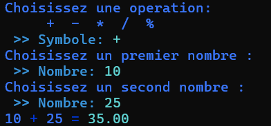
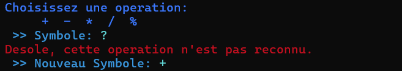
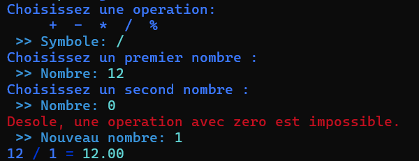

# Calculatrice

Bienvenue dans **coda-bnv-calculatrice**. Ce projet propose une calculatrice pour réaliser des opérations mathématiques.

<nav aria-label="Menu principal">
	<strong>Menu</strong>
	<ul>
		<li><a href="#fonctionnalites">Fonctionnalités</a></li>
		<li><a href="#installation-et-lancement">Installation et lancement</a></li>
		<li><a href="#exemples">Exemples</a></li>
		<li><a href="#auteur">Auteur</a></li>
	</ul>
</nav>


## Fonctionnalités

| Opérations | Etape 1 | Etape 2 | Etape 3 | Etape 4 | Etape 5 | Etape 6 |
| :-: | :-: | :-: | :-: | :-: | :-: | :-: |
| **+** | ❌ | ❌ | ❌ | ❌ | ✅ | ✅ |
| **-** | ❌ | ❌ | ❌ | ❌ | ✅ | ✅ |
| **x** | ❌ | ❌ | ❌ | ❌ | ✅ | ✅ |
| **/** | ❌ | ❌ | ❌ | ❌ | ✅ | ✅ |
| **%** | ❌ | ❌ | ❌ | ❌ | ✅ | ✅ |

## Installation et lancement

Ajoutez ici les prérequis, les étapes d'installation et la commande pour lancer l'application.

```bash
git clone "https://github.com/Clement-Poger/coda-bnv-calculatrice"
./coda-bnv-calculatrice/calculatrice
```

## Exemples

### Une addition
Cet exemple montre le fonctionnement normal de la calculatrice.



### Opérations non reconnues supportées
Cet exemple montre la réaction de la calculatrice en cas d'opérations non reconnues.



### Vérification dans le cas du Modulo et de la Division
Cet exemple montre la réaction de la calculatrice dans le cas où la seconde valeur est `0` alors que l'utilisateur a indiqué `division` ou `modulo`.



## Auteur
[**Clement Poger**](https://github.com/Clement-Poger)
