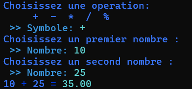
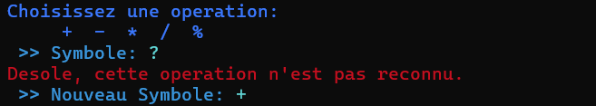
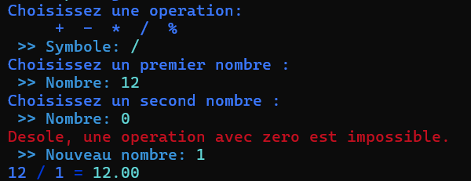

# Calculatrice

Bienvenue dans **coda-bnv-calculatrice**. Ce projet propose une calculatrice pour réaliser des opérations mathématiques.

<nav aria-label="Menu principal">
	<strong>Menu</strong>
	<ul>
		<li><a href="#fonctionnalites">Fonctionnalités</a></li>
		<li><a href="#installation-et-lancement">Installation et lancement</a></li>
		<li><a href="#exemples">Exemples</a></li>
		<li><a href="#auteur">Auteur</a></li>
	</ul>
</nav>


## Fonctionnalités

| Opérations | Etape 1 | Etape 2 | Etape 3 | Etape 4 | Etape 5 | Etape 6 |
| :-: | :-: | :-: | :-: | :-: | :-: | :-: |
| **+** | ❌ | ❌ | ❌ | ❌ | ✅ | ✅ |
| **-** | ❌ | ❌ | ❌ | ❌ | ✅ | ✅ |
| **x** | ❌ | ❌ | ❌ | ❌ | ✅ | ✅ |
| **/** | ❌ | ❌ | ❌ | ❌ | ✅ | ✅ |
| **%** | ❌ | ❌ | ❌ | ❌ | ✅ | ✅ |

## Installation et lancement

Ajoutez ici les prérequis, les étapes d'installation et la commande pour lancer l'application.

```bash
git clone "https://github.com/Clement-Poger/coda-bnv-calculatrice"
./coda-bnv-calculatrice/my_calculatrice
```

## Exemples

### Une addition
Cet exemple montre le fonctionnement normal de la calculatrice.



### Opérations non reconnues supportées
Cet exemple montre la réaction de la calculatrice en cas d'opérations non reconnues.



### Vérification dans le cas du Modulo et de la Division
Cet exemple montre la réaction de la calculatrice dans le cas où la seconde valeur est `0` alors que l'utilisateur a indiqué `division` ou `modulo`.



## Auteur

<p align="center">
	<a class="author-card" href="https://github.com/Clement-Poger">
		
		<span>Clement Poger</span>
	</a>
</p>

<style>
.author-card {
	display: inline-flex;
	align-items: center;
	gap: 12px;
	padding: 10px 20px;
	border-radius: 12px;
	background: linear-gradient(135deg, #46414f, #3f4a5a);
	color: #ffffff;
	font-weight: bold;
	text-decoration: none;
	box-shadow: 0 4px 12px rgba(60, 75, 99, 0.3);
	transition: all 200ms ease;
	animation: author-float 3s ease-in-out infinite;
}
.author-card:hover {
	transform: translateY(-5px) scale(1.03);
	box-shadow: 0 10px 22px rgba(59, 130, 246, 0.45);
	background: linear-gradient(135deg, #6e40c9, #3b82f6);
}
.author-avatar {
	border: 2px solid #ffffff;
	border-radius: 50%;
    height: 30px;
    width: 30px;
}
@keyframes author-float {
	0%, 100% { transform: translateY(0); }
	50% { transform: translateY(-3px); }
}
</style>
